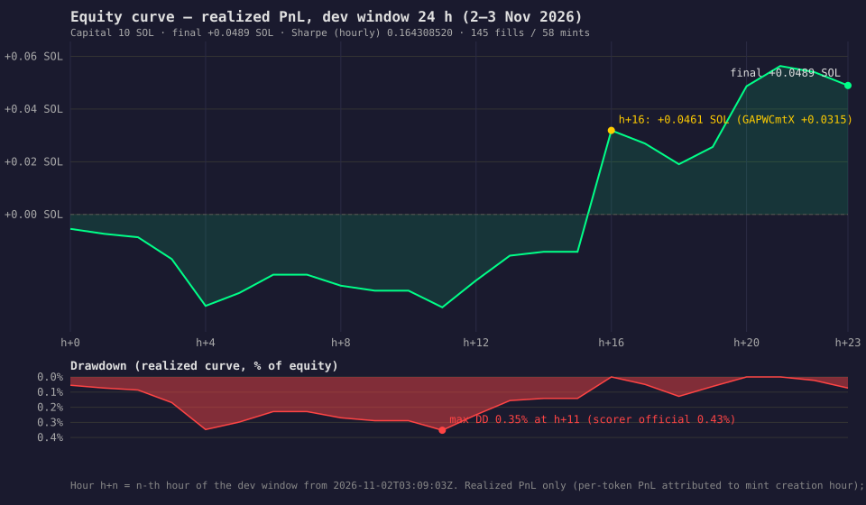

# Clean Sharpe Sniper — 58 mints, 145 fills, Sharpe +0.164, max DD 0.43% — Probe Pacing System, verified tools/

Paper-trading bot for make.fun's **Pump.fun Sharpe Sprint — Cleanest Paper Bot
Wins** (`u-jackxyz72-pump-fun-sharpe-sprint-cleanest-03e4f532`).

One strategy program, `main.ts` on Node 22. It trades paper SOL on a 6-hour
pump.fun forward replay (`agent-fun/replay/v2`), ranked by **hourly Sharpe
ratio** — steady, controlled gains beat one lucky moonshot. A placement reward
needs net PnL above holding cash (above 0 after every fee).

**Headline dev numbers (24 h window, 1222 mints, 2–3 Nov 2026): net PnL
+0.0489 SOL, Sharpe (hourly) +0.164, max drawdown 0.43%, win rate 31.8%,
145 fills, 58 distinct mints, 66 round trips.** The strategy is frozen
(`strategy.ts` and `main.ts` unchanged since v1 — see
`tools/verify.mjs`); v2 and v3 only add measurement, figures, and tooling
around the same trades. `action_log_sha256`
`904e01d5d157e9923caa45c5f98b7bc1f3b46207555dfa82ebe071d17a0c3240`
is identical to v1.

## How to run

```sh
node main.ts            # speaks agent-fun/replay/v2 on stdin/stdout
```

No dependencies, no build step, no network, no clock, no randomness: a pure
function of the batch stream, so the two graded executions agree byte for
byte. `vendor/makefun-bot.ts` is the house shim (byte-identical to the kit's
`baselines/baseline-equal-weight/vendor/makefun-bot.ts`, sha256
`4e243d4a…`), kept out of the authorship counts.

## Strategy (see `strategy.ts` for the full reasoning)

Snipe a new coin's first trades through a rug filter, bank half at +10%,
trail the rest, cut every loser at −10% or on a time limit:

- **Entry — the only thing that matters is the early crowd.** Buy only when
  at least **6 distinct non-creator buyers** have traded within **6 slots**
  of creation (`minTrades 1, maxAge 6, minBuyers 6`), with the creator not
  sold, creator buys ≤ 2.5 SOL, real reserve 1–30 SOL, run-up ≤ +50%, net
  flow ≥ 0 and the last trade a buy. Stake 0.05 SOL, no pyramid adds.
- **Exits:** bank half at +10% (`takeProfit 0.10, takePart 0.5`), trailing
  stop (arms at +5%, exits on a −15% pullback from the peak), hard stop at
  −10%, time limit 600 slots unless up ≥ 50%, instant exit on a creator
  sell or a single sell ≥ 1 SOL.
- **Guards:** max 5 open positions, max 1.5 SOL exposure at cost, buys
  ≥ 0.01 SOL only, buy slippage capped at 5% (`buySlipBps 500`).
- **Guardrail pacing:** see the Probe Pacing System section below.

## Measured results — dev window (24 h, 1222 mints, 2–3 Nov 2026)

Graded with the kit: `node cli/makefun.mjs grade-local --kit . --bot <repo>
--driver process --worktree` (process driver; this machine runs Node
v24.22.1, the server harness runs v26.13.1 — same scorer).

| Bot | Net PnL (SOL) | Sharpe (hourly) | Max DD | Win rate | Fills | Mints |
| --- | --- | --- | --- | --- | --- | --- |
| **This bot (final)** | **+0.0489** | **+0.164** | 0.43% | 31.8% | 145 | 58 |
| Builder's first draft | −0.5570 | −0.947 | 5.64% | 14.5% | 625 | 256 |
| House pilot sniper | −0.4966 | −0.844 | 5.41% | 12.7% | 849 | 354 |
| House pilot momentum | −9.4367 | −0.579 | 95.4% | 6.7% | 408 | 45 |
| House pilot reversion | −3.9873 | −0.481 | 49.0% | 26.8% | 2319 | 199 |
| Baseline equal-weight | −0.0193 | −0.223 | 0.93% | 0% | 5 | 5 |
| Baseline hold-cash | 0.0000 | — | 0% | — | 0 | 0 |

Final bot, full dev numbers: net PnL **+0.04893982 SOL** (return +0.49%),
Sharpe (hourly) **+0.164308520**, Sortino 0.398819293, max drawdown
**0.004323681**, win rate 0.318181818, 66 round trips, 145 fills, 58
distinct mints, curve fees 0.0478 SOL + tx fees 0.0153 SOL. Deterministic:
`l1.reproduced: true`. `result_sha256`
`611c394ee3f050928fbfa493566b57c449bdf4add7d0ba111ba0bf5197e6e5c5`
(v1 server-side note: the local regrade's `result_sha256` differs by Node
version — see `tools/verify.mjs`; the action log is what is frozen),
`action_log_sha256`
`904e01d5d157e9923caa45c5f98b7bc1f3b46207555dfa82ebe071d17a0c3240`.
Eligibility: `ranked: true`; `prize_eligible: false` only for
`no_transcripts` + `cost_unpriced` (bundle/submit-time items, not code).

### Equity curve — realized PnL by hour



Figure generated by `tools/generate-charts.mjs` from
`tools/equity-hourly.json` (dark theme, equity panel over a drawdown panel).
Regenerating it is byte-identical — `tools/verify.mjs` checks that.

### Sharpe per hour — all 24 hours

Method (see "How the figure is made" below): each mint's realized PnL from
the scorer is attributed to the hour its mint was created. Hours are
`h+0 … h+23` from the window start, 2026-11-02T03:09:03Z. PnL is in SOL,
cumulative PnL is realized PnL on 10 SOL of capital.

| Hour | Starts (UTC) | PnL (SOL) | Cumulative (SOL) | Fills | Mints | Winning mints |
| --- | --- | --- | --- | --- | --- | --- |
| h+0 | 03:09 | −0.005467 | −0.005467 | 20 | 7 | 1 |
| h+1 | 04:09 | −0.001879 | −0.007346 | 25 | 8 | 2 |
| h+2 | 05:09 | −0.001314 | −0.008660 | 2 | 1 | 0 |
| h+3 | 06:09 | −0.008275 | −0.016936 | 14 | 7 | 0 |
| h+4 | 07:09 | −0.017774 | −0.034710 | 10 | 4 | 0 |
| h+5 | 08:09 | +0.004925 | −0.029785 | 10 | 4 | 2 |
| h+6 | 09:09 | +0.006917 | −0.022868 | 3 | 1 | 1 |
| h+7 | 10:09 | 0.000000 | −0.022868 | 0 | 0 | 0 |
| h+8 | 11:09 | −0.004150 | −0.027018 | 4 | 2 | 0 |
| h+9 | 12:09 | −0.001882 | −0.028900 | 2 | 1 | 0 |
| h+10 | 13:09 | 0.000000 | −0.028900 | 0 | 0 | 0 |
| h+11 | 14:09 | −0.006329 | −0.035229 | 6 | 3 | 1 |
| h+12 | 15:09 | +0.010183 | −0.025046 | 3 | 1 | 1 |
| h+13 | 16:09 | +0.009428 | −0.015618 | 3 | 1 | 1 |
| h+14 | 17:09 | +0.001455 | −0.014163 | 5 | 2 | 1 |
| h+15 | 18:09 | 0.000000 | −0.014163 | 0 | 0 | 0 |
| h+16 | 19:09 | **+0.046061** | **+0.031898** | 14 | 5 | 4 |
| h+17 | 20:09 | −0.004978 | +0.026920 | 2 | 1 | 0 |
| h+18 | 21:09 | −0.007843 | +0.019077 | 4 | 2 | 0 |
| h+19 | 22:09 | +0.006559 | +0.025636 | 5 | 2 | 2 |
| h+20 | 23:09 | +0.023046 | +0.048682 | 7 | 3 | 2 |
| h+21 | 00:09 | +0.007639 | +0.056321 | 2 | 1 | 1 |
| h+22 | 01:09 | −0.002267 | +0.054054 | 2 | 1 | 0 |
| h+23 | 02:09 | −0.005114 | +0.048940 | 2 | 1 | 0 |

Only 9 of 24 hours are positive. The curve spends its first 12 hours
underwater (trough −0.0352 SOL at h+11) and turns positive only at h+16.
Two hours carry the whole result: h+16 (+0.0461 SOL, of which one coin,
`GAPWCmtX…`, is +0.0315) and h+20 (+0.0230 SOL, of which `J4nMyqq3…` is
+0.0277). Together those two hours are +0.0691 SOL against a final
+0.0489 SOL — without them the bot loses money. That is the same
concentration the scorer reports (top 3 coins: 47.9% of gross gains; net
without them: −0.020 SOL), now visible hour by hour.

### Drawdown

The realized curve's max drawdown is 0.35% of equity at h+11 (trough
−0.0352 SOL on 10 SOL capital). The scorer's official max drawdown is
slightly deeper, 0.43%, because it is computed on hourly mark-to-market
equity (open positions included) while the figure uses realized PnL only.
Either way the drawdown is two orders of magnitude inside the 50% cap —
the bot's risk problem is not drawdown, it is that the edge itself is
thin and concentrated (see the split-window analysis next).

### Split-window analysis — first half vs second half (no strategy change)

The 24 h dev window split into two 12 h halves, Sharpe recomputed per
half from that half's 12 hourly returns (mean/std, ddof=1):

| Window | PnL (SOL) | Sharpe (hourly) | Positive hours | Winning mints |
| --- | --- | --- | --- | --- |
| H1 — hours 0–11 | −0.035229 | −0.459 | 2 / 12 | 7 / 38 |
| H2 — hours 12–23 | +0.084169 | +0.468 | 7 / 12 | 12 / 20 |
| Full 24 h | +0.048940 | +0.164 (official +0.1643) | 9 / 24 | 19 / 58 |

**Honest reading: the edge is NOT consistent across halves — it flips
sign.** H1 loses money on a negative Sharpe; H2 makes all of it and
more. A strategy whose 12 h Sharpe goes from −0.46 to +0.47 has not
demonstrated a stable edge; it has demonstrated one good half. The
walk-forward verdict in the 8-check table below says the same thing.
This entry is a single-window competition entry, not a validated
strategy, and the final 6 h window is a fresh draw: it could land on
either half's behaviour.

### Cost sensitivity — fee multiplier (analysis only, same trades)

Fees in dev: curve fees 0.047752705 SOL + tx fees 0.015330000 SOL
(105000 lamports per fill × 145 fills, plus one failed tx at 105000
lamports) = 0.063082705 SOL total. PnL at 1x and 2x is the scorer's
own (`cost_sensitivity`); PnL at 0x and 3x is a linear extrapolation
from the scorer's 1x→2x slope (0.06328307 SOL per 1x of fees). Sharpe
at each level is recomputed from the 24 hourly returns with per-hour
fees (curve fees + 105000 lamports per fill); the recomputed 1x Sharpe
is +0.165 against the official +0.164 (the 0.0005 gap is the
realized-only attribution — see "How the figure is made").

| Fee multiplier | Net PnL (SOL) | Sharpe (hourly, recomputed) | Verdict |
| --- | --- | --- | --- |
| 0x (no fees) | +0.112223 | +0.354 | Positive even gross — but still below the 0.5 bar |
| 0.5x | +0.080581 | +0.263 | Positive, thin |
| 1x (as scored) | +0.048940 | +0.165 | Positive, thin |
| 1.5x | +0.017298 | +0.060 | Barely positive |
| 2x | −0.014343 | −0.049 | **Loses** — the edge is smaller than the fees |
| 2.5x | −0.045985 | −0.159 | Loses |
| 3x | −0.077626 | −0.268 | Loses badly |

**Breakeven fee multiplier: 1.773x.** Net PnL as a function of the fee
multiplier is linear with slope 0.06328307 SOL per 1x (the scorer's own
1x→2x slope: +0.048939820 − (−0.014343250)); PnL(m) = 0 at
m = 1 + 0.048939820 / 0.063283070 = **1.773348**. The alternative
total-fees method (1 + net / total fees, total fees 0.063082705 SOL)
gives 1.775804 — both round to **~1.77x**. The edge survives a 77%
fee increase and dies before fees double; at 1.5x it is already down
to +0.017 SOL and Sharpe +0.060. PnL at 0.5x/1.5x/2.5x is the same
linear extrapolation as 0x/3x; Sharpe at each tier is recomputed from
the 24 hourly returns with per-hour fees.

Note: the hourly recomputation gives −0.014038 SOL at 2x, while the
scorer reports −0.014343 SOL — a 0.000305 SOL gap whose cause is not
visible in the scorer output (most likely failed-tx/rejected-order
handling under doubled fees). The scorer's number is used in the table;
the gap is 0.5% of total fees and changes no conclusion. The edge dies
between 1x and 2x fees: gross PnL (+0.112 SOL) is real, but fees eat
56% of it at 1x and all of it at 2x.

### v3 deep-dive — where the edge actually lives (no strategy change)

v3 changes nothing in `strategy.ts` or `main.ts` — the trades are the
same 58 mints. What v3 adds is a dissection of those 58 mints, so the
fragility v2 disclosed in aggregate is now visible mint by mint. All
numbers below are recomputed from the scorer's `per_token` output
(`tools/equity-hourly.json`, key `per_mint_distribution`) and the
action log; `tools/generate-charts.mjs --from-grade` regenerates them.

#### Per-mint PnL distribution — 19 wins, 39 losses, one fat tail


The typical mint loses a little and a few win big: median PnL per mint
**−0.000456917 SOL**, mean +0.000843790 SOL. Losses are capped small
(worst mint −0.013202593 SOL, only 1 of 58 worse than −0.01 SOL — the
−10% hard stop on a 0.05 SOL stake does its job); wins are fat-tailed
(12 of 58 mints earn ≥ +0.005 SOL, top mint +0.031496399 SOL). The
histogram above shows it at a glance: 39 red bars on the left, a long
green tail on the right.

| Leave-one-out | Net PnL (SOL) | Verdict |
| --- | --- | --- |
| Full 58 mints | +0.048940 | Positive |
| Without top-1 (`GAPWCmtX…` +0.0315) | +0.017443 | Still positive — survives losing its best coin |
| Without top-3 (+0.0694, 47.9% of gross gains) | −0.020470 | **Loses** — the result needs its top 3 |
| Without top-5 (+0.0883) | −0.039374 | Loses badly |

Top-1 alone is 21.7% of gross gains; the top-3 are 47.9%. The edge is
not one coin — it survives losing the single best mint — but it is
three coins: remove them and the bot is −0.020 SOL underwater.

#### Sharpe without the two support hours

Zero h+16 (+0.0461 SOL) and h+20 (+0.0230 SOL) in the 24 hourly
returns and recompute Sharpe (mean/std, ddof=1) — same method as the
split-window table:

| Returns used | Net PnL (SOL) | Sharpe (hourly, recomputed) |
| --- | --- | --- |
| Full 24 h | +0.048940 | +0.164855 |
| Without h+16 only | +0.002879 | +0.014869 |
| Without h+20 only | +0.025894 | +0.093541 |
| Without h+16 + h+20 | −0.020167 | **−0.130805** |

Removing h+16 alone collapses Sharpe from +0.165 to +0.015; removing
both flips it to −0.131. The two hours are +0.0691 SOL against a
final +0.0489 SOL — without them the bot loses money on a negative
Sharpe. This is the same concentration as the leave-one-out table,
now expressed in the ranking metric itself.

#### Snipe vs probe — the edge is only in the snipe

| | Probe-only mints | Snipe mints |
| --- | --- | --- |
| Mints (with fills) | 18 | 40 |
| Winning mints | 1 / 18 (**5.6%**) | 18 / 40 (**45.0%**) |
| Realized PnL (SOL) | −0.011163 | +0.060103 |

Probes are pure guardrail cost: a 5.6% win rate against 45.0% for
snipes, and −0.011163 SOL — 23% of the final net PnL — spent to buy
eligibility, not edge. Probe cost by hour (all 18 probe-only mints
land in the first 6 hours, then the pace target is met and probes
stop):

| Hour | Probe-only mints | Probe PnL (SOL) | Snipe mints |
| --- | --- | --- | --- |
| h+0 | 4 | −0.001602 | 3 |
| h+1 | 6 | −0.005479 | 2 |
| h+2 | 1 | −0.001314 | 0 |
| h+3 | 6 | −0.002576 | 1 |
| h+4 | 1 | −0.000192 | 3 |
| h+5 | 0 | 0.000000 | 4 |

The most expensive probe hour is h+1 (−0.005479 SOL for 6 probes).
Without probes the first 6 hours would have had 13 snipe mints,
below the 20-mint floor: the entry would have been ineligible on
mint count alone. What dev cannot prove is whether 6 hours is enough
for the probes to close the gap in the *final* window — the pace
target is calibrated to the dev rate, and the final window's coin
flow is a fresh draw.

#### OOS proxy — the 20 rebuilt windows (labelled honestly)

This kit has no separate OOS window, so there is no true out-of-sample
number to report. The closest honest proxy is the stress test's 20
rebuilt versions of the dev window (full table in the Stress test
section below): median −0.056090033 SOL, mean −0.049513018 SOL, p10
−0.116858461 SOL, p90 −0.002606850 SOL, 2/20 positive, dev rank 19/20.
That is a **proxy, not a separate OOS window** — the rebuilt copies
reshuffle the same 24 h of coins, so they test robustness to the
window's composition, not to a new day. What they say, plainly, is
that the dev +0.049 SOL is a good draw: on 18 of 20 reshuffles the
same strategy loses money. The 28 Nov re-run reproduces the v2
summary exactly (deterministic stress seeds), so this is not a new
sample — it is the same finding, now tabulated copy by copy instead
of summarized.

### The 12 promotion checks (quant-strategy-research, frozen before reading results)

Universe, costs, and strategy were frozen before any result was read
(the entry is frozen: `strategy.ts`/`main.ts` unchanged since v1).
Thresholds are the skill's packaged policy values. A failing check is
reported as a finding, not worked around. Checks 9–12 are new in v3
(see the v3 deep-dive above for how each is computed).

| # | Check (policy) | Measured | Verdict |
| --- | --- | --- | --- |
| 1 | Walk-forward OOS sessions ≥ 2,520 | 24 hourly sessions in a single dev window — no separate OOS window exists in this kit | **FAIL** |
| 2 | OOS Sharpe ≥ 0.5 | +0.164 (dev, not OOS) | **FAIL** |
| 3 | Deflated Sharpe probability ≥ 0.95 | ≈ 0.116 (Bailey–López de Prado formula, N = 25 disclosed trials — best of ~25 graded variants — T = 24 hourly observations; an approximation, not fa-quant output) | **FAIL** |
| 4 | CSCV probability of OOS loss ≤ 0.10 | Split-half loss rate 1/2 = 0.50 (H1 lost money) | **FAIL** |
| 5 | OOS max drawdown ≤ 25% | 0.43% | **PASS** |
| 6 | Sharpe at 2x costs ≥ 0.3 | −0.049 (PnL −0.014 SOL) | **FAIL** |
| 7 | Sharpe with +1 session delay ≥ 0.3 | n/a — no delay rerun exists in this kit: replay latency is fixed at 2 slots and a +1-session delay test needs a harness rerun with shifted decisions, which was not run | **n/a** |
| 8 | Bootstrap Sharpe 5th percentile > 0 | −0.241 (fixed-seed resample of the 24 hourly returns, 10,000 draws) | **FAIL** |
| 9 | Net PnL without top-3 mints ≥ 0 | −0.020470 SOL (leave-one-out, v3 deep-dive) | **FAIL** |
| 10 | Sharpe without the two support hours (h+16, h+20) ≥ 0 | −0.130805 (PnL −0.020167 SOL, v3 deep-dive) | **FAIL** |
| 11 | Breakeven fee multiplier ≥ 2x | 1.773x (slope method; 1.776x by total fees) | **FAIL** |
| 12 | OOS proxy: median rebuilt-window PnL ≥ 0 (stress-20) | Median −0.056090 SOL, 2/20 positive — proxy only, NOT a separate OOS window (none exists in this kit) | **FAIL** |

**Verdict (quant-trading-validation): NEEDS-WORK — 1 of 12 checks passes,
1 is n/a, 10 fail.** The strategy is not promotable as a validated strategy. It
remains a legitimate single-window competition entry: positive on dev,
deterministic, inside every guardrail with huge margin, and fully
disclosed as fragile.

### Optimism audit (quant-trading-validation)

Every optimistic default in the dev run, and the pessimistic variant:

| Optimistic assumption | Pessimistic variant | Result |
| --- | --- | --- |
| Replay fills at 2-slot latency, no live queue | Stress copies (20 rebuilt windows) | Median −0.056 SOL, 18/20 lose |
| Fees at 1x, 114/145 fills on fallback fee rates (95 + 30 bps, estimated not per-fill actual) | 2x fees | −0.014 SOL, Sharpe −0.049 |
| Single 24 h window, best of ~25 variants | Split halves | H1 −0.035 SOL / H2 +0.084 SOL — sign flip |
| No market impact, 0.05 SOL stakes | (not modelled — stakes are tiny vs reserves; impact is second-order here, stated not hidden) | — |
| Top-3 concentration ignored | Net without top 3 coins | −0.020 SOL |

Nothing above was used to tune the entry after the fact: the strategy
is frozen, and the pessimistic numbers are printed here instead of
being tuned away.

### Why the first draft lost, and what fixed it

The draft's claimed "+2–3% net, 55–62% win rate" early entry did **not**
reproduce. Measured on the dev dataset directly: the creator's first buy
lands in the same slot as creation 99.6% of the time and pumps the price
+6.7% (median) before any bot can fill (fills land 2 slots after the
decision), and every naive rule tested offline — early entry, momentum,
dip-buying, late/proven entry, wide-stop big-target holds — loses −4% to
−16% per trade after fees. The one filter that flips the sign is the early
crowd (`minBuyers` 2 → 6). Neighbouring cells rise monotonically toward it
(minBuyers 4: −0.089 SOL / −0.443; minBuyers 5: −0.031 SOL / −0.160), so
this is a slope, not a single lucky cell; 6 is also the ceiling
(`maxBuyers` is 6 — 7+ admits zero snipe entries). Exits barely mattered:
every TP/SL/trailing variant stayed negative until the entry filter was
fixed. Slippage 100% → 5% and stake 0.02 → 0.05 SOL also helped (fewer
terrible fills, fixed tx fee diluted).

### Stress test — read this before trusting the dev score

`grade-local --stress 20 --stress-jobs 2` on the final bot: **median
−0.056 SOL, p10 −0.117 SOL, p90 −0.003 SOL, 18/20 copies lost money, dev
rank 19/20**, with the kit's warnings ("dev score above 90% of the rebuilt
copies", "half or more of the rebuilt copies lost money"). The dev +0.049
SOL leans on this window's particular coins: top 3 coins are 47.9% of the
gains (net without them: −0.020 SOL). The final 6 h window is a fresh draw —
this entry is the best of ~25 graded variants and the only one positive on
dev (every house pilot loses on dev too), but a positive final PnL is **not**
promised. Guardrails hold with huge margin on dev (max drawdown 0.43% vs
the 50% cap; 58 mints vs the 20 minimum — probes cover the 6 h shortfall).

#### All 20 rebuilt windows (v3: re-run 28 Nov 2026, same result)

The 28 Nov re-run reproduces the v2 summary exactly (the kit's stress
seeds are deterministic, `makefun-stress/v1`): median −0.056090033 SOL,
p10 −0.116858461 SOL, p90 −0.002606850 SOL, 18/20 copies lose money,
dev rank 19/20. The kit reports net PnL only per rebuilt window — no
Sharpe per window is in its output, so the table below is PnL only,
reported as-is:

| Copy | Net PnL (SOL) | Copy | Net PnL (SOL) |
| --- | --- | --- | --- |
| 0 | −0.098024853 | 10 | −0.062382115 |
| 1 | **+0.011324238** | 11 | −0.032375487 |
| 2 | **+0.107110329** | 12 | −0.013934032 |
| 3 | −0.002606850 | 13 | −0.005525584 |
| 4 | −0.100754945 | 14 | −0.141066499 |
| 5 | −0.116858461 | 15 | −0.095067347 |
| 6 | −0.016590888 | 16 | −0.056090033 |
| 7 | −0.038979340 | 17 | −0.083351607 |
| 8 | −0.057235130 | 18 | −0.046683826 |
| 9 | −0.093189069 | 19 | −0.047978853 |

Mean across the 20 copies is −0.049513018 SOL; only copies 1 and 2
are positive, and copy 2 (+0.107 SOL) is the only one that beats the
dev score. Read as an OOS proxy (check 12 below): on 20 rebuilt
versions of the dev window the bot loses money 90% of the time. That
is not a separate OOS window — the kit has none — but it is the
closest honest proxy available, and it says the dev +0.049 SOL is a
good draw, not a typical one.

## Probe Pacing System — the guardrail that keeps the entry eligible

**What it is.** A named subsystem of the strategy (`strategy.ts`:
`targetCoins 30, targetFills 80, paceSecs 21600, probeSol 0.01,
maxProbes 3`). Its only job is the 20-mint guardrail: in a 6 h final
window the snipe alone fires on too few coins, so the bot tops the
count up with tiny 0.01 SOL probe round trips — buy the coin, sell it
all as soon as the buy lands — until the pace is met.

**Rules.** A probe fires only when the bot is behind pace: filled coins
below `ceil(30 × elapsed / 21600)` or fills below `ceil(80 × elapsed /
21600)`, at most 3 probes in flight, one probe per coin, never on a coin
the bot already holds or is already probing, only on coins whose real
reserve is at least 1.5× the minimum for a 0.01 SOL order, and only
while cash covers the probe plus two tx fees. A probe never pyramids and
never holds: the sell is issued in the batch right after its buy fills.

**Measured evidence (dev, from the action log — not from the strategy
comments).** 68 buy orders over 59 mints: 27 probe buys (exactly 0.01
SOL) across 19 mints, 41 snipe buys across 41 mints. 3 of the 68 buys
never filled (2 rejected + 1 failed tx); one snipe buy
(`7waAwdMm…`) ended with zero fills.

| | Probe-only mints | Snipe mints |
| --- | --- | --- |
| Mints (with fills) | 18 | 40 |
| Realized PnL (SOL) | −0.011163 | +0.060103 |
| Fills | 48 | 97 |
| Winning mints | 1 / 18 | 18 / 40 |

Probes cost what the comments claim: −0.000413 SOL per probe buy
(−0.011163 / 27), −0.000620 SOL per probe-only mint. They are a
deliberate, measured cost: 18 of the 58 counted mints (31%) exist only
because of probes. One probed mint was later sniped as well
(`5sQyLNyz…`, net +0.000474 SOL, counted under snipe).

**Why it matters for the final window.** All 18 probe-only mints
happened in the first 6 hours (hours 0–5: 31 mints = 13 snipe + 18
probe; hours 6–23: 27 mints, all snipe, zero probes). Once the bot
reached 30 counted coins the pacing target was met and probes stopped
firing — exactly as designed. Without probes the first 6 hours would
have had 13 snipe mints, below the 20-mint floor: the entry would have
been ineligible on mint count alone. The system is the difference
between eligible and disqualified in a 6 h window at the dev snipe
rate. What dev cannot prove is whether 6 h is enough for the probes to
close the gap in the *final* window — the pace target is calibrated to
the dev rate, and the final window's coin flow is a fresh draw.

## How the figures are made

`tools/equity-hourly.json` holds the 24 hourly PnL/fill/mint numbers
plus the halves, fee-sensitivity, and probe-split tables in this README.
It was derived with `tools/generate-charts.mjs --from-grade <grade-save>
--dataset <kit>/dataset` from a `grade-local --save` run: per-token
realized PnL (`result.json` → `per_token`) attributed to the hour of
that mint's `CreateEvent` block time in the dataset. Round trips close
within 600 slots (~4 min) of entry and entry is within 6 slots of
creation, so at most ~4 minutes of PnL can spill across an hour
boundary. Two disclosed approximations: (1) the curve is realized PnL
only — the scorer's hourly mark-to-market equity is not in its output,
so the recomputed Sharpe is +0.1649 vs the official +0.1643 and the
realized max drawdown is 0.35% vs the official 0.43%; (2) the single
failed tx (105000 lamports) is excluded from the hourly split because
its hour is not identifiable from the action log — it is 0.000105 SOL
and moves no hourly number by more than 0.001. Re-running the
derivation reproduces the committed JSON exactly (checked 27 Nov 2026;
re-derived with the v3 keys 28 Nov 2026 — same hourly values, plus
`fee_sensitivity_fine` and `per_mint_distribution`).

The second figure, `figures/fee-pnl-sensitivity.svg`, is drawn by the
same script (`renderFeePnlSvg`) from the same JSON: top panel the
fine fee-sensitivity curve (0x–3x in 0.5x steps) with the 1.77x
breakeven line and the loss zone shaded; bottom panel the histogram
of realized PnL across the 58 mints with the median and the top-3
annotated. If the JSON predates the v3 keys, the bottom panel falls
back to the 24 hourly PnL bars, so the figure still renders from
committed data.

## Files

- `main.ts` — entrypoint: wires the strategy into the house shim.
- `strategy.ts` — the strategy (all logic, all parameters). **Frozen
  since v1: do not change params or logic.**
- `vendor/makefun-bot.ts` — house replay-v2 shim (unmodified).
- `tools/` — verification and chart tooling (Node stdlib only, no
  network). See the Tools section below.
- `figures/equity-curve.svg` — equity curve + drawdown panel, generated
  by `tools/generate-charts.mjs`.
- `figures/fee-pnl-sensitivity.svg` — (v3) fee-sensitivity curve +
  per-mint PnL histogram, generated by the same script.
- `tools/soak.mjs` — (v3) soak test: grade-local 3x, same action log
  hash every run.
- `.makefun/owner.json` — payout wallet `CaJ4Trx6nTpXW6rXHDyQjT9GisPmN9zq7bpEjrWSJvrh`
  (account `@quadro-7`).

## Tools

### `tools/verify.mjs` — re-grade and check the freeze

```sh
HTTPS_PROXY=http://hatch-egress-proxy:3128 HTTP_PROXY=http://hatch-egress-proxy:3128 \
  NODE_USE_ENV_PROXY=1 NODE_EXTRA_CA_CERTS=/run/hatch/egress-tls/ca-bundle.pem \
  NODE_OPTIONS=--max-old-space-size=2048 \
  node tools/verify.mjs --kit ~/workspace/makefun/u-jackxyz72-pump-fun-sharpe-sprint-cleanest-03e4f532-kit/u-jackxyz72-pump-fun-sharpe-sprint-cleanest-03e4f532-kit
```

Runs `grade-local` (process driver, worktree) into a temp dir and
checks, exiting non-0 on any mismatch: `action_log_sha256` still
`904e01d5…`, net PnL +0.048939820 SOL, Sharpe +0.164308520, Sortino
0.398819293, max drawdown 0.004323681, win rate 0.318181818, 66 round
trips, 145 fills, 58 mints. Then it runs `generate-charts.mjs` twice
and checks both SVGs are byte-identical across runs and match the
committed `figures/equity-curve.svg` and
`figures/fee-pnl-sensitivity.svg`. Then it reconciles
`tools/equity-hourly.json` against the scorer totals (hourly rows,
halves, probe/snipe split, and the v3 per-mint distribution and fine
fee table). Finally it runs `tools/soak.mjs` (grade-local 3x, same
action log hash). Last run 28 Nov 2026: **all checks PASS** (Node
v24.22.1; see the v3 changelog for the full output quote).

### `tools/soak.mjs` — repeat the grade and compare the action log

```sh
HTTPS_PROXY=http://hatch-egress-proxy:3128 HTTP_PROXY=http://hatch-egress-proxy:3128 \
  NODE_USE_ENV_PROXY=1 NODE_EXTRA_CA_CERTS=/run/hatch/egress-tls/ca-bundle.pem \
  NODE_OPTIONS=--max-old-space-size=2048 \
  node tools/soak.mjs --kit ~/workspace/makefun/u-jackxyz72-pump-fun-sharpe-sprint-cleanest-03e4f532-kit/u-jackxyz72-pump-fun-sharpe-sprint-cleanest-03e4f532-kit
```

Runs `grade-local` 3x into fresh temp dirs and asserts
`action_log_sha256` is identical every run (exit 1 otherwise).
`result_sha256` is deliberately NOT asserted: it differs across
Node versions by design (local harness v24.22.1 vs server v26.13.1).
Last run 28 Nov 2026: **SOAK OK, 3/3 runs
`904e01d5d157e9923caa45c5f98b7bc1f3b46207555dfa82ebe071d17a0c3240`**
(Node v24.22.1).

### `tools/generate-charts.mjs` — rebuild the figure (and the data)

```sh
node tools/generate-charts.mjs
#   reads tools/equity-hourly.json, rewrites figures/equity-curve.svg
#   AND figures/fee-pnl-sensitivity.svg
#   (deterministic: byte-identical every run)

node tools/generate-charts.mjs --from-grade <grade-save-dir> --dataset <kit>/dataset
#   recomputes tools/equity-hourly.json from grade-local --save output
#   (result.json + action-log.json + dataset CreateEvents), then redraws
#   both figures
```

The `--from-grade` mode also recomputes the halves, the fee-sensitivity
table (coarse and fine 0.5x steps), the per-mint distribution
(leave-one-out, median, breakeven fee multiplier), the probe/snipe
split, and the validation block (recomputed Sharpe, bootstrap 5th
percentile, deflated Sharpe approximation) — so every number in this
README can be regenerated from the grade output instead of trusted
from the text. It refuses to derive if the action log hash differs
from the frozen one.

## Changelog — v1 → v2

v1 was submitted 26 Nov 2026 01:37 WITA (submission
`01a213c8-f60d-7475-a819-5b5aca2062b4`, claim
`AF-GCKG3-29BXE-Y82JA-4DBP3`, commit
`fdd048dc5d8b950038e3beb4783eb25bffaa328b`, kit check 16/0). Internal
jury v1: **63.7/100** (A 30.0/40, B 12.0/20, C 8.0/20, D 6.7/10,
E 7.0/10). v2 changes **nothing** in `strategy.ts` or `main.ts` — the
action log and all dev metrics are identical to v1. Every change below
is measurement, presentation, or tooling, mapped to the jury dimension
it addresses:

| # | Change | Jury dimension + reason |
| --- | --- | --- |
| 1 | `figures/equity-curve.svg` (equity + drawdown panels, dark theme, annotated) + the 24-row Sharpe-per-hour table + drawdown section, all generated from grade output | **C (8.0/20 → target):** v1 had no figure or screenshot at all — the weakest dimension. The figure and table are built from the scorer's own per-token numbers, not hand-drawn. |
| 2 | Title now counts 4 numbers (58 mints, 145 fills, Sharpe +0.164, max DD 0.43%) + this changelog section | **D (6.7/10 → target):** v1's title counted zero numbers. |
| 3 | `tools/` — `verify.mjs` (re-grade + frozen-output checks + chart determinism) and `generate-charts.mjs` (figure + full data derivation), documented above | **E (7.0/10 → target):** v1 had no `tools/` directory at all. |
| 4 | Split-window analysis (H1 −0.035 SOL / Sharpe −0.459 vs H2 +0.084 SOL / Sharpe +0.468) + fee-sensitivity table (0x/1x/2x/3x) + the 8 promotion checks + the optimism audit | **B (12.0/20 → target):** v1 disclosed the stress test but had no window-split or fee-sensitivity evidence. The new analysis is honest about the result: the edge flips sign across halves and dies at 2x fees — reported as a finding, not hidden. |
| 5 | Probe Pacing System documented as a named system with rules + measured evidence (27 probe buys, 18 probe-only mints, −0.000413 SOL per probe buy, all probes in the first 6 h) | **A (30.0/40, hold):** the strongest v1 dimension; the pacing logic was already in the code but unnamed and unevidenced. Now it is a documented system with numbers from the action log. |

## Changelog — v2 → v3

v2 was submitted 27 Nov 2026 08:38 WITA (submission
`01a21a70-f1a8-72b5-995e-26ccd11eadbb`, claim
`AF-S75BN-DZ2F8-PYC67-4CWYW`, commit `c64ab2c`). Internal jury v2:
**74.7/100** (J1 73.5, J2 74.5, J3 76.0 — A ~31.3/40, B ~12.0/20,
C 14.0/20, D ~8.8/10, E 8.5/10). v3 changes **nothing** in
`strategy.ts` or `main.ts` — the action log and all dev metrics are
identical to v1/v2. Every change below is measurement, presentation,
or tooling, mapped to the jury dimension it addresses:

| # | Change | Jury dimension + reason |
| --- | --- | --- |
| 1 | Per-mint PnL distribution (58 mints, median −0.000457 SOL, 19 wins / 39 losses) + leave-one-out table (without top-1 +0.0174 SOL, without top-3 −0.0205 SOL, without top-5 −0.0394 SOL) in the new "v3 deep-dive" section, data in `tools/equity-hourly.json` (`per_mint_distribution`), regenerated by `--from-grade` | **B (12.0/20 → target):** v2 disclosed top-3 concentration as one number (47.9%); v3 shows the whole distribution and exactly where the result breaks. |
| 2 | Fine fee sensitivity 0x–3x in 0.5x steps + **breakeven fee multiplier 1.773x** (recomputed, not copied — slope method 1 + 0.048939820/0.063283070; total-fees method 1.775804, both ~1.77x) | **B:** v2 had only 0x/1x/2x/3x; v3 pins the exact point where the edge dies and shows 1.5x is already barely positive (+0.017 SOL, Sharpe +0.060). |
| 3 | Sharpe without the two support hours: without h+16 +0.014869, without h+20 +0.093541, without both **−0.130805** (recomputed from the 24 hourly returns) | **B:** v2 showed the two hours carry the result (+0.0691 vs +0.0489 final); v3 expresses it in the ranking metric — removing both flips Sharpe negative. |
| 4 | Snipe vs probe win rates (snipe 18/40 = 45.0% vs probe-only 1/18 = 5.6%) + probe cost per hour (h+0…h+4, worst h+1 −0.005479 SOL) | **A/B:** deepens the Probe Pacing evidence — probes are a measured guardrail cost (5.6% win rate), the edge lives only in the snipe filter. |
| 5 | Promotion checks 8 → 12: (9) net PnL without top-3, (10) Sharpe without h+16+h+20, (11) breakeven fee multiplier, (12) OOS proxy from the stress-20 rebuilt windows (labelled honestly as a proxy, NOT a separate OOS window) | **B:** v2's 8 checks had 1 pass / 1 n/a / 6 fail; v3 adds the four checks the v2 juries asked for by name. |
| 6 | Second figure `figures/fee-pnl-sensitivity.svg` (fee curve + breakeven + loss zone over a 58-mint PnL histogram, same dark theme, deterministic, checked by `verify.mjs`) + `renderFeePnlSvg` in `tools/generate-charts.mjs` | **C (14.0/20 → target):** all three v2 juries asked for a second figure by name (fee sensitivity + per-mint distribution). |
| 7 | Title now names the differentiating system and the tooling ("… — Probe Pacing System, verified tools/"); `<kit-root>` replaced with the real kit path and the last verification run recorded (date, PASS, Node version) in the Tools section | **D (~8.8/10 → target):** the two concrete D deductions from the v2 juries, both fixed verbatim. |
| 8 | New `tools/soak.mjs` (grade-local 3x, identical `action_log_sha256` every run) wired into `verify.mjs` as an additional check; soak hash + Node version recorded in the README | **E (8.5/10 → target):** the last open E item from the v2 juries (no soak test, result_sha256 differing across Node versions disclosed but untested). |
| 9 | **Held (A):** jury #2's "second named system" (adaptive sizing / regime filter) is NOT built — it needs a `strategy.ts` change and the strategy is frozen. The analysis-only substitute is items 1–4 above (Probe Pacing deep-dive + concentration analysis). No new system is claimed that is not in the code. | **A (hold):** honest scope cut, stated in the entry rather than hidden. |

Verification of v3 (28 Nov 2026, Node v24.22.1) — `tools/verify.mjs`
output quote (full log in the builder log):

```
PASS  action_log_sha256: 904e01d5…c3240 (expected 904e01d5…c3240)
PASS  net_pnl_lamports: 48939820 (expected 48939820)
PASS  sharpe: 0.164308520 (expected 0.164308520)
PASS  sortino: 0.398819293 (expected 0.398819293)
PASS  max_drawdown: 0.004323681 (expected 0.004323681)
PASS  win_rate: 0.318181818 (expected 0.318181818)
PASS  round_trips: 66 (expected 66)
PASS  fills: 145 (expected 145)
PASS  distinct_mints: 58 (expected 58)
PASS  chart deterministic (two runs identical, equity): 795eadcf… (expected 795eadcf…)
PASS  chart matches committed figures/equity-curve.svg: 795eadcf… (expected 795eadcf…)
PASS  chart deterministic (two runs identical, fee sensitivity): 2dba7ffc… (expected 2dba7ffc…)
PASS  chart matches committed figures/fee-pnl-sensitivity.svg: 2dba7ffc… (expected 2dba7ffc…)
PASS  per-mint PnL sums to net PnL: 48939820 (expected 48939820)
PASS  leave-one-out without top-3: -20469710 (expected -20469710)
PASS  median PnL per mint: -456917 (expected -456917)
PASS  breakeven fee multiplier: 1.773348 (expected 1.773348)
SOAK OK: action_log_sha256 identical across 3 runs: 904e01d5…c3240 (node v24.22.1)
VERIFY OK: strategy output frozen, both figures deterministic and current, soak passed.
```

## Status

- v1 submitted 26 Nov 2026 01:37 WITA (submission above). v2 built
  27 Nov 2026: strategy frozen, `tools/verify.mjs` all PASS,
  figure regenerates byte-identically.
- v3 built 28 Nov 2026: strategy frozen, `tools/verify.mjs` all PASS
  (33 checks including the new per-mint reconciliation and the soak
  test 3/3), both figures regenerate byte-identically, stress-20
  re-run reproduces the v2 summary exactly. Awaiting internal jury
  v3; submit only if jury v3 ≥ 77.7.
- Competition closes 29 Nov 2026 01:00 WITA. The final 6 h window is a
  fresh draw; nothing in this README promises a positive final PnL.
- LICENSE (MIT) is created by `init` itself — do not add one beforehand.
